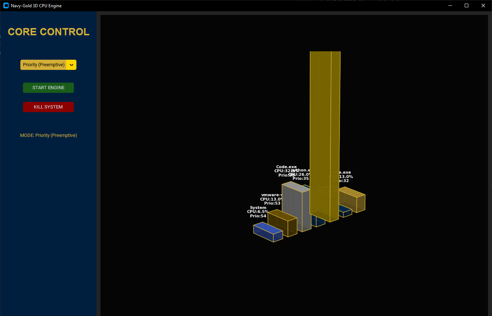

# CPU Scheduling Visualizer — Navy-Gold 3D CPU Engine


A desktop GUI (CustomTkinter + Matplotlib 3D) that visualizes classic CPU scheduling algorithms using your **real, live running processes** instead of synthetic data. Each process is rendered as a rotating 3D bar whose height reflects its current CPU usage, with its position/order driven by the selected scheduling algorithm.

## Features

- **Live process data** — pulls real processes and CPU usage from the OS via `psutil`.
- **Switchable scheduling algorithms:**
  - FCFS (Non-Preemptive)
  - SJF (Non-Preemptive)
  - Priority (Non-Preemptive)
  - SRTF (Preemptive)
  - Priority (Preemptive)
  - Round Robin (Preemptive)
- **Animated 3D visualization** — auto-rotating bar chart (Matplotlib `Axes3D` + `FuncAnimation`), Navy & Gold themed.
- **Start / Stop controls** and a live status readout of the active algorithm.

> Note: the scheduling "logic" here re-sorts the live process snapshot on every frame according to the selected algorithm's ordering rule (e.g. by CPU%, by a randomized priority, shuffled for Round Robin) — it's a visualization/teaching aid for how each algorithm *orders* work, not a kernel-level scheduler simulation with simulated burst/wait times.

## Screenshot



*Live 3D view of real running processes on the host machine, ordered by the Priority (Preemptive) algorithm.*

## Requirements

- Python 3.9+
- Works on Windows/Linux/macOS (anywhere `psutil` + Tkinter are available)

## Installation

```bash
git clone https://github.com/Scorpion691/CPU-Scheduling-Visualizer.git
cd CPU-Scheduling-Visualizer
pip install -r requirements.txt
```

## Usage

```bash
python cpu_scheduling_visualizer.py
```

1. Pick a scheduling algorithm from the dropdown.
2. Click **START ENGINE** to begin the live 3D animation.
3. Click **KILL SYSTEM** to stop it.

## Building a standalone .exe

A PyInstaller spec file is included:

```bash
pip install pyinstaller
pyinstaller cpu_scheduling_visualizer.spec
```

## Tech stack

Python · CustomTkinter · Matplotlib (3D) · NumPy · psutil

## License

MIT — see [LICENSE](LICENSE).
